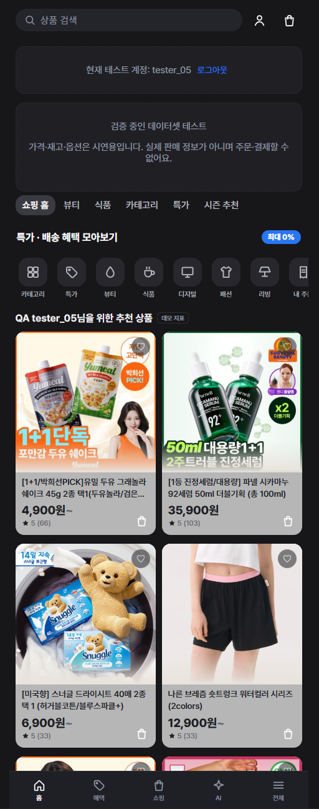
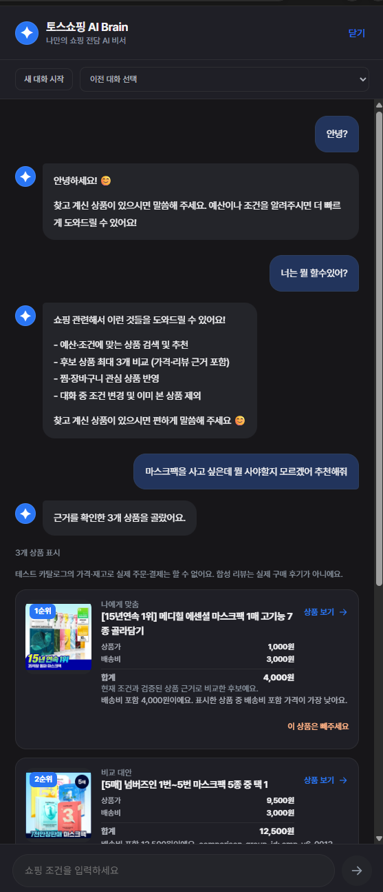
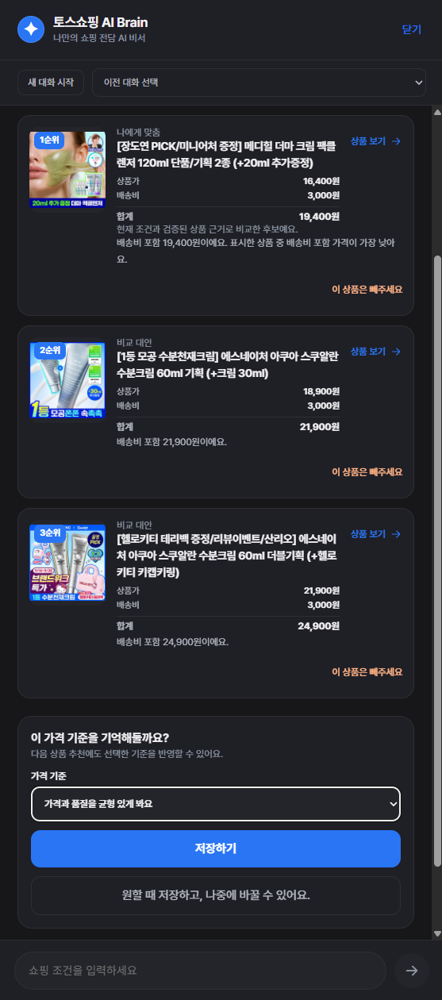
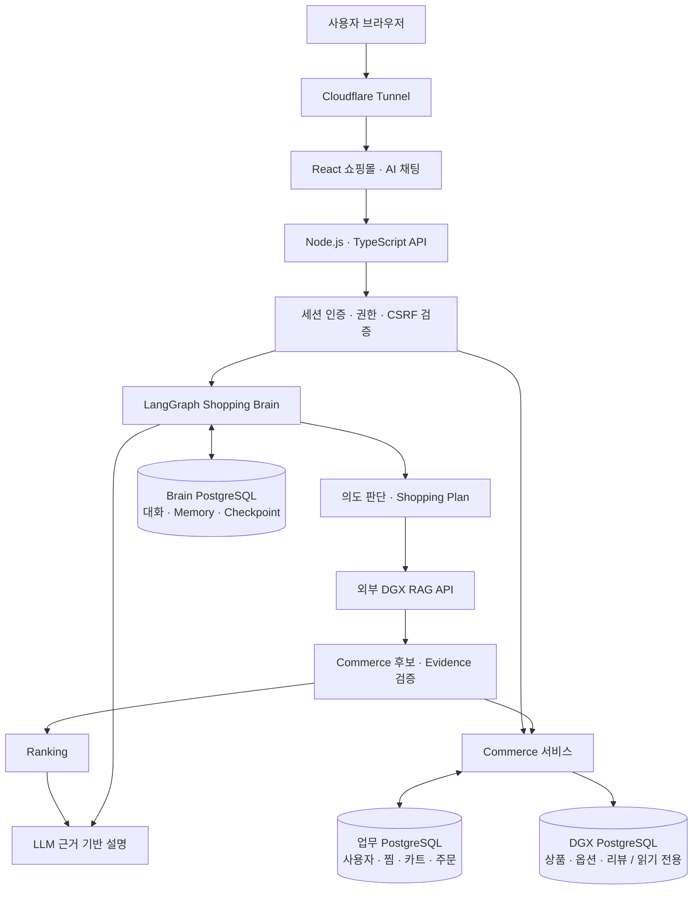

# 토스쇼핑 AI Brain

**사용자의 조건과 대화 맥락을 이해하고, 확인된 상품·리뷰를 바탕으로 추천 이유를 설명하는 AI 쇼핑 비서입니다.**

**Team 토스와 함께 · 코디세이 AI Native Final Project**

“예산에 맞는 상품을 찾아줘”에서 “이 상품을 왜 추천하는지 설명해줘”까지, 상품 탐색과 비교를 하나의 대화로 이어갑니다.

팀 **토스와 함께**는 프로젝트 기획 당시 제공된 **토스 AI Engineer의 Brain 관련 채용 공고**를 참고해, 의도 파악·RAG·도구 연동·맥락 관리·평가 역량을 실제 서비스로 보여주고자 했습니다. 그중 **쇼핑 추천**에 집중해 Commerce 기반 위에 LangGraph 기반 AI Shopping Brain을 연결했습니다. 사용자의 요청을 이해하는 것부터 상품 검증, 추천 이유 설명, 피드백에 따른 개선까지가 이 프로젝트의 범위입니다.

이 저장소는 서비스 소스와 개발 이력, 실행 설정 및 검증 코드를 담은 제출용 저장소입니다. 토스쇼핑 경험을 참고한 교육용 프로젝트이며, 토스의 공식 서비스가 아닙니다.

[프로젝트 소개](#1-프로젝트-소개) · [주요 기능](#2-주요-기능) · [아키텍처](#4-시스템-아키텍처) · [실행 방법](#8-실행-방법) · [사용자 피드백](#10-사용자-피드백과-개선) · [팀 소개](#11-팀-토스와-함께)

> 문서 초안: 팀 구성과 팀원 5명의 테스트 참여를 반영했습니다. 테스트 기간·정량 결과, 발표 자료·시연 영상은 추가 예정입니다. 기능 설명은 제출 코드 기준이며, 공개 서버의 현재 가용성은 별도 확인이 필요합니다.

## 1. 프로젝트 소개

### 출발점 — 채용 역량을 실제 서비스로 증명하기

코디세이 Final Project를 통해 좋은 포트폴리오를 만들고자 했습니다. 팀이 정한 기준은 **관심 직무에서 요구하는 일을 직접 수행하고, 그 과정과 결과를 설명할 수 있는 프로젝트**였습니다.

기획 당시 참고한 토스 AI Engineer 채용 공고는 사용자 의도와 맥락 이해, RAG와 Tool Calling, 프롬프트·에이전트 설계, 평가와 Guardrail, 사용자 피드백을 통한 개선을 강조했습니다. 이를 읽고 다음과 같은 과제를 정했습니다.

> 사용자가 원하는 상품을 대화로 찾도록 돕고, 실제 상품·리뷰와 연결된 근거를 제시하며, 테스트에서 발견한 문제를 개선하는 쇼핑 AI를 만든다.

공고에 명시된 업무·요구 역량의 **약 60~70% 이상을 프로젝트에서 다뤄보는 것**을 기획 목표로 삼았습니다. 이 비율은 달성률이나 채용 적합성 평가 결과가 아닙니다. 구현 여부는 아래의 코드·실험·사용자 피드백 근거로 설명하며, 실시간 음성·멀티모달 인식이나 상용 규모 운영까지 구현했다고 주장하지 않습니다.

### 해결하려는 문제

상품을 선택하려면 가격과 옵션을 확인하고, 여러 리뷰를 읽고, 자신의 용도와 예산에 맞는지 비교해야 합니다. 검색어를 바꾸거나 조건을 추가할 때 앞서 정한 내용을 다시 설명해야 하는 불편도 있습니다.

이 프로젝트는 이러한 탐색 과정을 대화로 이어갈 수 있도록 만듭니다. AI가 사용자의 조건을 기억하고 상품과 리뷰를 찾아 설명하되, 가격 계산과 상품 식별, 접근 권한 등 정확성이 필요한 판단은 서버에서 검증합니다.

### 접근 방식 — Commerce 위에 추천 Brain 연결

먼저 상품 탐색·상세·옵션·리뷰와 찜·장바구니·주문 관련 화면 및 API를 갖춘 Commerce 기반을 구성했습니다. AI가 추천한 상품을 사용자가 실제 상세 화면에서 확인하고, 같은 상품·옵션 식별자를 서비스 흐름에서도 사용할 수 있도록 하기 위해서입니다.

그 위에 **요청 이해 → 필요한 조건 확인 → 상품·리뷰 검색 → Commerce 검증 → 순위 결정 → 추천 이유 설명**을 연결했습니다. LLM은 맥락 해석과 설명을 맡고, 서버는 가격 계산·데이터 관계·필수 조건·접근 권한을 검증합니다.

이번 프로젝트의 중심은 **상품 선택을 돕는 추천 경험**입니다. Commerce 전체를 기반으로 활용하되, 실제 결제나 주문·취소의 자율 실행까지 완성한 서비스로 범위를 넓혀 설명하지 않습니다. 코드 구현, 환경별 활성 기능, 실제 검증 결과는 각각 구분합니다.

### 보여주고자 한 역량과 구현 근거

아래 항목은 프로젝트 기획 당시의 공고 내용을 프로젝트 관점에서 정리한 것입니다. 현재 채용 공고의 원문이나 공식 평가 기준을 대체하지 않습니다.

| 주목한 역량 | 프로젝트에서 다룬 문제 | 확인할 구현·자료 |
| --- | --- | --- |
| 사용자 의도·맥락 이해 | 일반 대화·검색·리뷰 요청을 구분하고, 후속 대화에서도 예산과 조건 유지 | [Graph](src/brain/graph.ts), [Shopping Plan](src/brain/shopping-plan.ts), [Context](src/brain/context.ts) |
| RAG·도구 및 서비스 연동 | 검색된 상품·리뷰를 실제 Commerce 데이터와 연결하고 식별자 검증 | [RAG Adapter](src/brain/rag-adapter.ts), [Commerce Retriever](src/brain/commerce-retriever.ts), [RAG 계약](docs/BRAIN_RAG_V1_CONTRACT.md) |
| 프롬프트·에이전트 설계 | 대화·추가 질문·추천 경로와 공통 페르소나, 근거 표현 범위 정의 | [Policy](src/brain/policy.ts), [Decisions Routing](docs/decisions-routing.md), [응답 생성](src/brain/grounded-response.ts) |
| 개인화·상태 관리 | 현재 탐색 조건과 사용자 승인 장기 선호를 구분하고 대화 간 활용 | [Memory](src/brain/memory.ts), [개인화](src/brain/personalization.ts), [영속 저장](src/brain/persistent-store.ts) |
| 평가·품질과 비용의 균형 | 임베딩 구성별 검색 지표·처리 비용 비교, 가격·리뷰 정렬 회귀 검증 | [임베딩 비교 보고서](docs/reports/rag-embedding-model-comparison-test-items2-beauty-2026-10-19.pdf), [평가 자료](eval/), [테스트](tests/) |
| Guardrail·실행 안전성 | 상품·리뷰 근거, 사용자 소유권, 동의와 오래된 실행 결과 통제 | [근거 응답 검증](src/brain/grounded-response.ts), [Fencing](src/brain/fenced-turns.ts), [데이터 격리 정책](docs/DATA_ISOLATION_POLICY.md) |
| 피드백 기반 개선 | 반복 질문·내부 용어·가격 조건·특정 상품 리뷰 처리 문제 수정 | [사용자 피드백과 개선](#10-사용자-피드백과-개선), [검증 결과](#9-검증-결과와-실행-명령) |

기술을 사용했다는 사실과 효과를 입증한 결과는 구분합니다. 예를 들어 임베딩 비교 수치는 제한된 beauty 평가셋의 결과이며, 전체 서비스 추천 정확도나 구매 전환율을 뜻하지 않습니다.

### 대상 사용자

- 상품 후보가 많아 비교와 선택에 시간이 걸리는 사용자
- 예산·용도·중요 속성을 말로 설명하며 상품을 찾고 싶은 사용자
- 긴 리뷰에서 장점과 단점, 서로 다른 의견을 파악하고 싶은 사용자
- 이전에 전달한 조건과 저장한 선호를 다음 탐색에도 활용하고 싶은 사용자

### 설계 원칙

1. **대화 맥락 유지:** 현재 Shopping Plan, 최근 대화, 사용자가 승인한 장기 선호를 목적에 맞게 활용합니다.
2. **필요할 때 검색:** 일반 대화, 추가 질문, 상품 추천, 특정 상품 리뷰 요약을 구분합니다.
3. **검증된 사실로 설명:** 상품·옵션·가격은 Commerce에서, 리뷰 주장은 해당 상품과 연결된 리뷰 근거에서 확인합니다.
4. **명시적 조건 우선:** 예산은 필터로 적용하고, 사용자가 지정한 정렬 기준은 일반 개인화 점수보다 우선합니다.
5. **사용자 동의와 격리:** 장기 선호 저장은 확인 절차를 거치며, 대화와 Memory는 사용자별로 관리합니다.

## 2. 주요 기능

| 기능 | 구현 내용 |
| --- | --- |
| 대화형 상품 탐색 | 자연어 요청에서 상품 유형·예산·선호를 해석하고 후속 대화에서 유지·수정 |
| 필요한 조건만 질문 | 상품군을 결정하기 어려운 경우 확인 질문 제공, 명확한 상품 요청에는 불필요한 공통 용도 질문 생략 |
| 근거 기반 추천 | 검색 후보를 Commerce로 검증한 뒤 최대 3개 상품과 추천 이유 표시 |
| 가격 범위 처리 | `2만원대`는 20,000~29,999원, `1~3만원대`는 10,000~39,999원으로 해석하고 확인된 배송비 포함 합계로 필터링 |
| 리뷰 기준 정렬 | 확인된 긍정 리뷰 표본을 원본 리뷰 ID로 중복 제거하고, 명시적 정렬 기준에 반영 |
| 특정 상품 리뷰 요약 | 상품을 식별한 뒤 해당 상품의 리뷰에서 주요 평가·장점·단점·상반된 의견 요약 |
| 개인화 Memory | 사용자가 승인한 선호 저장·조회 및 추천 맥락 반영 |
| 대화 관리 | 새 대화, 기존 대화 복귀, 현재 탐색 조건 변경 및 상품 제외 |
| 쇼핑몰 UI | 카테고리·검색·필터·상품 상세·옵션·리뷰·찜·장바구니·주문 관련 화면과 API |

**Commerce 코드의 구현 범위와 외부 카탈로그 QA에서 허용되는 기능은 다릅니다.** 외부 DGX 카탈로그는 읽기 전용으로 연결하며, 해당 환경의 찜·카트·주문 쓰기는 기존 안전 정책의 적용을 받습니다. 실제 결제 서비스 연동이나 모든 주문 기능의 공개 QA 완료를 의미하지 않습니다.

### 서비스 화면

팀이 제공한 QA 화면입니다. 쇼핑몰 탐색에서 AI 대화, 상품별 가격 비교와 선호 저장으로 이어지는 구성을 보여줍니다.

<table>
  <tr>
    <th>쇼핑몰 상품 탐색</th>
    <th>AI 대화 · 상품 추천</th>
    <th>추천 비교 · 개인화 저장</th>
  </tr>
  <tr>
    <td valign="top"></td>
    <td valign="top"></td>
    <td valign="top"></td>
  </tr>
</table>

## 3. 사용자 흐름

```text
사용자 요청
  ├─ 일반 대화 / 기능 질문 → 대화 응답
  ├─ 상품 식별이 모호함 → 필요한 확인 질문 → 사용자 답변
  ├─ 특정 상품 리뷰 요청 → 상품 식별 → 해당 리뷰 조회 → 근거 기반 요약
  └─ 상품 검색 / 후속 조건 변경
       → Shopping Plan 갱신
       → Hybrid RAG 검색
       → Commerce 상품·옵션·가격·근거 검증
       → 필수 조건 필터 + 명시적 정렬 또는 개인화 Ranking
       → 추천 이유 생성 + 상품 카드
```

예를 들어 “1~3만원대에서 촉촉하다는 긍정 리뷰가 많은 순으로 추천해줘”라는 요청에서는 가격 범위와 리뷰 정렬을 별도로 처리합니다. 배송비 포함 금액이 범위를 벗어나면 제외하고, 같은 리뷰의 여러 청크는 한 건으로 집계합니다. 비교할 리뷰 근거가 부족하면 해당 순위가 입증됐다고 설명하지 않습니다.

## 4. 시스템 아키텍처



- **프론트엔드:** 쇼핑 탐색 화면, AI 채팅, 상품 카드, 대화 및 선호 관리 UI를 제공합니다.
- **Commerce:** 가격·옵션·재고·주문 상태와 데이터 관계를 서버에서 관리합니다.
- **Brain:** LangGraph가 대화·질문·검색·리뷰 요약 경로를 연결합니다.
- **외부 DGX:** 상품 카탈로그 조회와 RAG 검색을 담당합니다. 연결은 Tailscale 및 서버가 요구하는 인증·TLS 설정을 사용합니다.
- **저장소 분리:** 외부 상품 DB 연결 때문에 로컬 사용자·카트·주문 또는 Brain DB를 교체하지 않습니다.

현재 QA 운영 방식은 로컬 Windows 서버를 Cloudflare Tunnel로 외부에 공개하는 구조입니다. Cloudflare Workers에 앱을 배포한 구조가 아닙니다.

## 5. 핵심 AI 활용과 선택 이유

| 요소 | 활용 방식 | 선택 이유 |
| --- | --- | --- |
| AI Agent / LangGraph | `prepare → route` 후 대화·Plan·검색·리뷰 요약으로 분기 | 상태와 실행 단계를 명시하고 후속 대화 및 복구 처리에 활용 |
| Hybrid RAG | BM25·Vector 검색 및 결합 결과를 기존 검색 계약으로 수신 | 키워드 일치와 의미 검색을 함께 활용 |
| LLM | 의도 해석, 자연스러운 대화, 검증 후보의 추천 이유와 리뷰 요약 | 한국어 요청과 문맥을 해석하고 근거를 이해하기 쉽게 설명 |
| Long-term Memory | 사용자 확인을 거친 선호를 PostgreSQL에 저장 | 대화가 바뀌어도 승인된 개인화 정보 활용 |
| 서버 검증 | 가격 계산, 상품·옵션·리뷰 ID, 필수 조건, 정렬, 권한 확인 | 모델 출력만으로 사실이나 실행 권한을 확정하지 않도록 보장 |

### 의도 판단과 응답

`BRAIN_ROUTE_MODE`에 따라 규칙 기반 경로 또는 OpenAI Decisions 분류 경로를 선택합니다. 자연어 응답 Provider는 별도 설정하며, Claude 연결을 지원합니다. 실제 모델과 엔드포인트는 서버 환경변수로 지정합니다. `.env.example`을 복사하는 것만으로 Decisions와 Claude가 모두 활성화되는 것은 아닙니다.

공통 페르소나·추천 정책·근거 검증·보안 지침은 [`src/brain/policy.ts`](src/brain/policy.ts)에 정의되어 있습니다. 상품과 리뷰에 포함된 명령문은 상위 지침으로 취급하지 않으며, 생성된 상품·리뷰 주장은 서버의 근거 검사 대상입니다.

### 추천과 리뷰의 구분

리뷰가 부족해도 상품·옵션·가격과 필수 조건이 검증되면 확인된 상품 정보로 추천할 수 있습니다. 다만 리뷰에 근거한 장단점이나 효능은 별도 근거 없이 생성하지 않습니다. 검색된 리뷰 표본을 전체 리뷰 통계로 확대하지 않고 REAL/SYNTHETIC 출처를 유지합니다.

### 대화와 Memory

현재 탐색 조건은 Shopping Plan으로 관리하고, 대화 실행 상태는 Checkpoint로 보존합니다. 장기 Memory는 사용자의 최종 확인 이후 저장합니다. 새 대화를 시작하는 것과 대화 삭제·장기 기억 삭제는 다른 동작입니다. 사용자 소유권 검사, 멱등성 및 Fencing을 통해 중복 요청과 오래된 실행 결과가 상태를 잘못 덮어쓰는 상황을 제어합니다.

### 임베딩 모델 비교 실험 — 검색 품질과 처리 비용

RAG 비교 자료에서는 **같은 청크와 질의에서 임베딩 모델을 바꿨을 때 상품 검색 순위가 어떻게 달라지는지** 평가했습니다. BM25 단독과 기존 MiniLM 구성을 기준선으로 두고 multilingual-e5-large, BGE-M3, Qwen3-Embedding-0.6B를 비교했습니다.

📄 [임베딩 모델 비교 보고서 원문 — 2026-10-19](docs/reports/rag-embedding-model-comparison-test-items2-beauty-2026-10-19.pdf)

#### 실험 조건

| 항목 | 조건 |
| --- | --- |
| 평가 데이터 | `test_items2`의 **beauty 범주만** 평가 |
| 규모 | 상품 781개 · 리뷰 34,545개 · 청크 78,595개 |
| 리뷰 출처 | 실수집 32,207개 · 합성 2,338개 |
| 청킹 | 별도 활성 run에 이미 생성된 최대 96토큰 청크 재사용 |
| 질의 | 범주 내 긍정 질의 10개 + 범위 밖(OOD) 질의 2개 |
| 정답 기준 | 상품명·유형 규칙으로 생성한 임시 기대 상품 목록, 사람 관련성 검수 전 |
| 검색 결합 | 고정 BM25 Top 20 + 모델별 dense Top 20 → 상품 단위 RRF, `k=60` |
| 결과 크기 | 질의별 최대 5개 상품 |
| 통제 조건 | 최대 입력 128토큰, 별도 리랭커·답변 생성 모델 없음 |

모델 효과와 청킹 효과가 섞이지 않도록 청크를 다시 나누지 않았습니다. MiniLM은 기존 384차원 벡터를 재사용했고, 세 대안 모델은 동일 청크를 임시 공간에서 각각 임베딩했습니다. BGE-M3는 dense 벡터만 비교했으며 sparse·multi-vector 기능은 평가하지 않았습니다.

#### 검색 품질 결과

| 검색 구성 | 차원 | Hit@1 | Hit@5 | Macro Recall@5 | Macro MRR@5 | Macro Precision@5 |
| --- | ---: | ---: | ---: | ---: | ---: | ---: |
| BM25 단독 | — | 60% (6/10) | 100% (10/10) | 0.540 | 0.767 | 0.400 |
| BM25 + MiniLM-L12-v2 | 384 | 40% (4/10) | 100% (10/10) | 0.451 | 0.595 | 0.360 |
| BM25 + multilingual-e5-large | 1,024 | 80% (8/10) | 100% (10/10) | 0.620 | 0.883 | 0.580 |
| BM25 + BGE-M3 dense | 1,024 | 80% (8/10) | 100% (10/10) | 0.627 | 0.900 | 0.580 |
| BM25 + Qwen3-Embedding-0.6B | 1,024 | 80% (8/10) | 100% (10/10) | 0.608 | 0.883 | 0.580 |

- **Hit@1 / Hit@5:** 첫 결과 또는 상위 5개 안에 기대 상품이 하나 이상 포함된 질의의 비율입니다. 전체 추천 정확도나 사용자 만족도를 뜻하지 않습니다.
- **Macro Recall@5:** 질의별 기대 상품 중 찾은 비율의 평균입니다.
- **Macro MRR@5:** 상위 5개 안에서 첫 기대 상품 순위의 역수를 평균한 값입니다.
- **Macro Precision@5:** 질의별 상위 5개 중 기대 상품 비율의 평균입니다. 반환 후보가 5개 미만이어도 분모는 5로 계산했습니다.

이 표본에서 세 대안 모델은 MiniLM보다 첫 결과의 기대 상품 일치 비율이 높았습니다. BGE-M3의 MRR@5가 가장 높았지만, 긍정 질의가 10개라 한 질의가 10%p를 차지하고 임시 라벨에 결과가 영향을 받습니다. **특정 모델이 전체 서비스에서 우수하다고 확정한 결과는 아닙니다.**

#### 로컬 CPU 처리 비용

| 구성 | 78,595개 청크 문서 임베딩 시간 | 질의 임베딩 p50 / p95 |
| --- | ---: | ---: |
| MiniLM-L12-v2 | 기존 벡터 재사용, 재임베딩 시간 미측정 | 4.2 / 12.4 ms |
| multilingual-e5-large | 90.3분 | 21.6 / 27.2 ms |
| BGE-M3 dense | 48.9분 | 135.2 / 143.9 ms |
| Qwen3-Embedding-0.6B | 173.2분 | 53.0 / 58.9 ms |

MiniLM·E5·Qwen3는 FastEmbed 0.9.0 ONNX CPU, BGE-M3는 Transformers CPU bfloat16 경로를 사용했으며 모두 8 threads 조건입니다. 문서 임베딩 시간에는 모델 로드·DB 저장·인덱스 작성이 포함되지 않습니다. 질의 시간은 12개 질의의 측정치이며, **DGX GPU 성능이나 실제 검색 API·AI 답변의 전체 응답 시간이 아닙니다.**

#### 해석과 후속 검증

1. **품질과 비용을 함께 비교합니다.** 보고서는 E5와 BGE-M3를 우선 비교할 후보로 제시했습니다. E5는 이 환경에서 질의 임베딩이 더 빨랐고, BGE-M3는 문서 임베딩 시간이 더 짧았습니다. 실행 라이브러리와 정밀도도 다르므로 모델 자체의 성능 차이로만 해석하지 않습니다.
2. **범위 밖 요청 처리는 별도로 필요합니다.** 키보드·세탁세제 질의 2개 모두 모든 구성에서 상품을 반환했습니다. 거절 임계값을 설정하지 않은 실험이므로 OOD 제어의 성공 결과가 아니며, 관련성 판단과 질문·거절 동작을 별도로 평가해야 합니다.
3. **평가셋을 보강해야 합니다.** 사람 검수 정답과 더 다양한 질의로 재평가하고 beauty 외 범주까지 확인해야 합니다. 후보 데이터 자체의 적합성 검수도 남아 있습니다.
4. **실험과 운영 적용을 구분합니다.** 보고서 작성 당시 평가 프로필은 서비스 API에 연결되지 않았으며, DB 쓰기·DDL·인덱스 변경 없이 오프라인에서 비교했습니다. 저장 벡터는 MiniLM 384차원이었습니다. 1,024차원 모델을 도입하려면 문서·질의 임베딩 공간과 DB 인덱스·코드의 차원 검증을 함께 맞춰야 하며, 기존 벡터와 섞을 수 없습니다.

위 수치는 첨부 보고서의 실험 결과를 옮긴 것이며, 이 제출 저장소에서 이번에 다시 실행한 결과가 아닙니다. 원문의 이전 `test_items` 비교 문서 링크는 해당 자료가 제출본에 없어 연결되지 않을 수 있습니다.

## 6. 기술 스택

| 구분 | 기술 | 사용 목적 |
| --- | --- | --- |
| 언어 / 런타임 | TypeScript, Node.js 24 | 프론트·백엔드 계약 공유 및 서버 실행 |
| 프론트엔드 | React 19, CSS, esbuild | 쇼핑몰·AI 채팅 UI 및 번들 생성 |
| AI 실행 흐름 | LangGraph, PostgreSQL Checkpointer | 상태 기반 분기와 실행 상태 저장 |
| LLM 연결 | Claude, OpenAI Decisions 연동 코드 | 응답 생성과 의도 분류 역할 분리 |
| 데이터베이스 | PostgreSQL, postgres 클라이언트 | Commerce·개인화 데이터 관리 |
| 검색 | 외부 DGX Hybrid RAG API | 상품·리뷰 Evidence 검색 |
| 연결 / 공개 QA | Tailscale, Cloudflare Tunnel | 외부 데이터 서버 연결 및 사용자 접근 |
| 검증 | Node.js Test Runner, Playwright, GitHub Actions | 단위·통합·브라우저 회귀 테스트 |
| 로컬 DB 구성 | Docker Compose | 별도 개발 DB 구성 |

## 7. 데이터셋과 저장소 범위

연결 대상으로 사용하는 `test_items2`의 기준 규모는 다음과 같습니다. 현재 서버 값은 연결 시 별도로 확인해야 합니다.

| 항목 | 기준 |
| --- | --- |
| 상품 / 옵션 / 리뷰 | 1,500 / 1,917 / 46,100 |
| 카테고리 | beauty, fashion, food, living |
| 카탈로그 | PostgreSQL `toss.test_items2` |
| RAG API | `POST /v1/rag/search`, profile `test_items2` |

이 저장소에는 **서비스 소스, 외부 연결 코드, Migration, 소형 합성 fixture, 테스트 및 설정 예시**가 포함됩니다. DGX RAG 서비스 자체의 소스, 실제 DB 덤프, 전체 상품·리뷰 원본, 청크·임베딩, 인증정보는 포함하지 않습니다. 제공된 청크·임베딩은 재사용하며, 데이터셋을 변경할 때는 버전과 ID 정합성을 확인하고 이전 근거가 새 추천에 섞이지 않도록 처리합니다.

## 8. 실행 방법

### 요구사항

- Node.js 24 및 npm
- 별도 로컬 PostgreSQL 또는 Docker Compose
- 전체 AI 실행 시: Brain 전용 DB, 승인된 LLM 자격증명, 외부 RAG·카탈로그 접근 권한

### 설치

```bash
git clone https://github.com/hongbinwee/codyssey-final-project-toss-shopping-ai-brain.git
cd codyssey-final-project-toss-shopping-ai-brain
npm ci
```

`.env.example`을 `.env`로 복사하고 환경에 맞게 설정합니다. 실제 `.env`, 비밀번호 파일, 세션 Secret, 테스트 접근 코드, 인증서는 Git에 올리지 않습니다.

### A. 소형 합성 데이터로 기본 Commerce 실행

다음은 **새로운 로컬 개발 DB**를 사용하는 절차입니다. 기존 QA DB나 DGX에 Migration·Seed를 실행하지 않습니다.

1. `.secrets/pg-password`에 직접 정한 로컬 DB 비밀번호를 저장합니다. `compose.yaml`과 `.env`의 `DATABASE_PASSWORD_FILE`이 이 파일을 함께 사용합니다.
2. `.env`의 `DATABASE_URL`이 새 로컬 DB를 가리키는지 확인하고 `SESSION_SECRET`을 설정합니다. 초기 확인에서는 `BRAIN_ENABLED=0`, `COMMERCE_CATALOG_SOURCE=public`, 외부 카탈로그 URL은 공란으로 둡니다.
3. 아래 명령을 실행합니다. 기본 포트 5432가 사용 중이면 기존 프로세스를 종료하지 말고 Compose와 접속 설정을 함께 조정합니다.

```bash
docker compose up -d db
# PostgreSQL 준비 완료 후:
npm run db:migrate -- --phase=6
npm run db:seed -- --phase=4
npm run build
npm start
```

기본 접속 주소는 `http://localhost:3000`입니다. 테스트 사용자 매핑은 `.env.example`과 합성 `db/seeds/users.json`을 참고합니다. 이 경로는 기본 Commerce 확인용이며 실제 DGX 상품이나 실시간 LLM 추천을 재현하는 절차는 아닙니다.

### B. 외부 DGX와 Shopping Brain 연결

[`docs/EXTERNAL_SERVICES.md`](docs/EXTERNAL_SERVICES.md)에 저장소별 연결 경계와 비밀값 없는 환경변수 예시를 정리했습니다.

| 설정 | 역할 |
| --- | --- |
| `DATABASE_URL` | 로컬 업무 DB |
| `BRAIN_DATABASE_URL` | 별도의 `brain_*` DB; URL에 인증정보 필요 |
| `CATALOG_DATABASE_URL` 및 비밀번호·TLS 파일 설정 | 외부 카탈로그 읽기 전용 조회 |
| `BRAIN_RAG_URL`, `BRAIN_RAG_PROFILE`, `BRAIN_RAG_DATASET_VERSION` | 검색 API 및 정확한 데이터 버전 |
| `LLM_PROVIDER`, `LLM_BASE_URL`, `LLM_API_FORMAT`, `LLM_MODEL`, `LLM_API_KEY` | 실제 자연어 응답 Provider |
| `BRAIN_ROUTE_MODE`, `OPENAI_DECISIONS_API_KEY` | 선택적 Decisions 분류 |
| `SESSION_SECRET`, `QA_AUTH_FILE`, `BRAIN_PUBLIC_ORIGIN` | 인증 및 공개 QA 설정 |

Brain DB는 Commerce DB와 별도로 준비해야 합니다. 새 로컬 Brain DB에만 명시적으로 스키마를 생성합니다. 아래는 PowerShell 예시이며 기존 운영 데이터베이스에 반복 실행하는 배포 절차가 아닙니다.

```powershell
$env:BRAIN_MIGRATE_APPROVED = "1"
node --env-file=.env scripts/brain-migrate.ts
Remove-Item Env:BRAIN_MIGRATE_APPROVED
```

이후 `.env`에 `BRAIN_ENABLED=1`, 외부 카탈로그·RAG·LLM 및 인증 설정을 완료하고 서버를 실행합니다. 외부 서버 자격증명이 없으면 해당 연결을 사용하는 전체 AI 경로는 실행할 수 없습니다.

## 9. 검증 결과와 실행 명령

제출용 패키징 시점(2026-10-20)에 아래 검증을 수행했습니다.

| 검증 | 결과 | 범위 |
| --- | --- | --- |
| Typecheck | PASS | 제출용 소스 전체 타입 검사 |
| Build | PASS | 프론트엔드 번들 생성 |
| 선택한 핵심 회귀 | 58/58 PASS | 가격 범위·리뷰 정렬/요약·근거 검증·데이터셋 상태·외부 카탈로그 연결 계약 |
| 실제 Claude / DGX / 공개 화면 | 이번 패키징에서 미실행 | 단위·Mock 결과를 실제 서비스 품질 결과로 대체하지 않음 |

```bash
npm run check
npm run build
node --test tests/unit/brain-price-band.test.ts tests/unit/brain-qa09-price.test.ts tests/unit/brain-review-sort.test.ts tests/unit/brain-review-summary.test.ts tests/unit/brain-review-summary-response.test.ts tests/unit/external-catalog.test.ts tests/unit/brain-dataset-state.test.ts tests/unit/brain-recommendation-quality.test.ts
```

DB·브라우저 통합 테스트는 격리된 테스트 DB와 필요한 실행 환경을 구성한 뒤 수행합니다. `npm run verify`와 일부 과거 E2E 진입점에는 보호 가드가 있으므로 전체 검증의 일괄 실행 명령으로 안내하지 않습니다. CI는 [brain-check.yml](.github/workflows/brain-check.yml)에 정의되어 있으며, 위 로컬 결과를 제출 저장소 CI 통과 결과로 해석하지 않습니다.

## 10. 사용자 피드백과 개선

### 테스트 참여와 범위

**팀원 전원인 5명(위홍빈·김영두·김찬욱·이가온·김서현)이 서비스 테스트에 참여했습니다.** 개발 과정에서 사용자 관점으로 쇼핑·대화 흐름을 사용하고, 결과를 QA 항목으로 정리해 수정 요구사항에 반영했습니다.

| 항목 | 확인된 내용 |
| --- | --- |
| 참여 인원 | 5명, 팀원 전원 |
| 참여자 구분 | 프로젝트 참여자의 내부 사용자 테스트 |
| 피드백 대상 | 쇼핑 화면, 대화 UX, 추천 조건, 리뷰 근거, 개인화 저장 등 |
| 피드백 관리 | QA 번호별 증상·기대 동작·수정 요구사항 정리 |
| 외부 사용자 테스트 | 참여 여부와 인원 미확인 |
| 추가 정리 항목 | 테스트 기간, 시나리오별 수행 인원·성공률, 수정 후 재검증 기록 |

계정 개수가 아닌 실제 참여 인원으로 기록했습니다. 내부 팀원 테스트와 외부 사용자 검증은 구분하며, 미션의 실사용자 요건 인정 범위는 제출 기준에 따라 확인합니다.

### 주요 피드백과 반영 내용

테스트에서 드러난 문제는 단순한 화면 오류에 그치지 않았습니다. 이미 전달한 조건을 다시 묻는 문제, 가격 범위와 정렬 기준이 어긋나는 문제, 특정 상품의 리뷰 요청이 추천으로 바뀌는 문제처럼 **사용자가 기대한 행동과 AI의 실제 처리 흐름 사이의 차이**를 중심으로 개선했습니다.

아래는 **코드에 반영한 개선 내역**입니다. 모든 항목의 실제 사용자 재검증 완료를 뜻하지는 않습니다.

| 피드백 | 반영한 개선 | 개선 의도 |
| --- | --- | --- |
| 질문이 입력창에 남아 전송 여부가 불분명함 | 사용자 메시지 즉시 표시, 실패 시 원문과 재시도 경로 유지 | 기다리는 상태와 실패한 상태를 구분하고 질문 유실 방지 |
| 내부 용어와 중복 안내로 답변이 읽기 어려움 | Markdown·문단 렌더링, 서비스 페르소나 및 사용자 안내 정리 | 사용자가 상품 선택에 필요한 정보를 먼저 이해하도록 구성 |
| 일상용·선물용 질문이 반복됨 | 명확한 요청은 검색하고 필요한 경우에만 질문 | 이미 전달한 조건을 유지하며 불필요한 대화 단계 축소 |
| 가격 범위와 리뷰 정렬이 요청대로 반영되지 않음 | 최소·최대 합계 필터, 명시적 리뷰 정렬과 원본 ID 중복 제거 | 가격 조건을 지키고 사용자가 요청한 근거로 비교 |
| 특정 상품의 리뷰를 묻는데 다른 상품이 추천됨 | 상품 식별과 리뷰 요약을 별도 경로로 처리 | 현재 질문의 대상 상품과 요청 목적 유지 |
| 선호가 저장됐는지 알기 어려움 | 저장 확인·완료 상태와 개인화 관리 UI 개선 | 사용자가 저장에 동의한 내용과 실제 처리 결과를 이해하도록 개선 |

### 피드백을 구현으로 연결한 방식

```text
실제 사용 중 발견한 문제
    → 입력·응답·화면 상태와 기대 동작 기록
    → UI / 의도 판단 / 검색 / 데이터 검증 / 상태 저장 원인 구분
    → 관련 기능 수정 및 핵심 회귀 테스트
    → 실제 서비스 재확인과 후속 피드백
```

코드 테스트와 실제 서비스 테스트는 다른 증거로 관리합니다. 단위 테스트가 통과하더라도 실제 Claude 응답 품질, 외부 서버 지연, 공개 화면에서의 사용성까지 검증됐다고 보고하지 않습니다. 정량 성과는 테스트 기록이 확보된 항목에 한해 추가할 예정입니다.

## 11. 팀 토스와 함께

**기획과 서비스 구현, 데이터베이스, 검색, AI 에이전트 설계를 맡은 5명이 하나의 쇼핑 경험을 연결했습니다.**

쇼핑 AI는 화면이나 모델 한 부분만으로 완성되지 않습니다. 사용자 질문을 이해하는 과정, 검색할 데이터의 구조, 관련 근거를 찾는 방식, 실제 상품 정보와의 연결, 최종 답변과 화면 표현이 함께 맞아야 합니다. 팀은 이 흐름에 맞춰 담당 영역을 나누고, 전원이 서비스 테스트에 참여했습니다.

### 역할과 담당 영역

| 팀원 | 역할 | 담당 영역 |
| --- | --- | --- |
| **위홍빈** | **서비스 기획 · 프론트엔드 · 백엔드** | 서비스 요구사항과 사용자 흐름 기획, 쇼핑몰·AI 채팅 화면 및 백엔드 구현 |
| **김영두** | **데이터베이스 설계 · 운영 · 관리** | 서비스 데이터 구조 설계와 데이터베이스 운영·관리 |
| **김찬욱** | **RAG 비교 실험 · 구현 · 평가** | 이가온과 공동으로 검색 증강 생성 영역의 비교 실험, 구현 및 평가 |
| **이가온** | **RAG 비교 실험 · 구현 · 평가** | 김찬욱과 공동으로 검색 증강 생성 영역의 비교 실험, 구현 및 평가 |
| **김서현** | **AI 에이전트 · 시스템 프롬프트** | AI 에이전트와 시스템 프롬프트의 직접 설계·구현·검증 |

### 위홍빈 — 사용자의 요청을 실제 서비스 흐름으로 연결

서비스 기획과 프론트엔드·백엔드를 담당했습니다. 사용자가 상품을 탐색하고 AI와 대화하는 과정을 요구사항으로 정리하고, 이를 쇼핑 화면과 서버 기능으로 구현하는 영역입니다.

프로젝트에서 이 역할은 **사용자 입력 → 서버 처리 → 상품·대화 결과 표시**를 하나의 경험으로 연결합니다. 검색·상세·옵션 같은 쇼핑 흐름과 조건 확인·추천 카드·대화 관리 같은 AI 흐름이 같은 서비스 안에서 이어지도록 구성하는 데 의미가 있습니다.

### 김영두 — 상품과 사용자 상태를 지탱하는 데이터 기반

데이터베이스의 설계와 운영·관리를 담당했습니다. 서비스가 사용하는 데이터를 구조화하고, 애플리케이션에서 필요한 정보를 조회·관리할 수 있도록 하는 영역입니다.

이 프로젝트에서 데이터베이스는 상품·옵션·리뷰의 관계를 확인하는 기반이면서, 사용자별 상태를 보존하는 저장소입니다. **AI가 설명할 수 있는 상품 사실과 서비스가 관리하는 사용자 상태의 신뢰성**을 뒷받침하는 역할입니다.

### 김찬욱 · 이가온 — 검색 근거를 확보하는 RAG 공동 담당

RAG 영역의 비교 실험·구현·평가를 공동으로 담당했습니다. 상품과 리뷰에서 질문에 관련된 정보를 검색하고, AI가 활용할 수 있는 근거로 연결하는 영역입니다. 두 사람의 세부 실험별 분담과 개별 성과는 현재 제공된 정보만으로 나누어 기재하지 않았습니다.

RAG 영역의 비교 자료로 [test_items2/beauty 임베딩 모델 보고서](docs/reports/rag-embedding-model-comparison-test-items2-beauty-2026-10-19.pdf)를 함께 제공합니다. BM25와 네 임베딩 구성의 검색 지표·CPU 처리 비용을 같은 평가 흐름에서 비교하고, 라벨과 평가 규모의 한계 및 운영 적용 조건을 기록한 자료입니다. 보고서에 개인별 실험 수행자가 명시되어 있지 않아 공동 담당 영역의 자료로 소개합니다.

서비스에서 RAG의 역할은 사용자의 질문을 관련 상품과 리뷰 근거에 연결하는 것입니다. **검색된 결과가 질문과 얼마나 관련 있는지, 추천이나 비교를 설명할 근거가 있는지**가 이후 Commerce 검증과 응답 품질에 영향을 줍니다. 비교 실험·구현·평가는 이 검색 단계를 살펴보는 공동 업무입니다.

### 김서현 — AI의 판단과 표현을 서비스 목적에 맞게 설계

AI 에이전트와 시스템 프롬프트를 직접 설계·구현·검증했습니다. 사용자의 요청을 어떤 관점으로 해석하고, 어떤 역할과 지침에 따라 답변해야 하는지 구체화하는 영역입니다.

이 프로젝트에서 에이전트와 프롬프트 설계는 **대화의 자연스러움과 근거에 대한 신중함을 함께 유지하는 것**에 연결됩니다. 공통 페르소나, 추천 원칙, 리뷰 근거의 표현 범위와 같은 정책은 실제 백엔드 검증 및 프론트 응답 방식과 함께 작동하도록 구성되어 있습니다. 팀 전체 구현 결과와 개인의 세부 코드 기여는 구분해 설명합니다.

### 함께 검증한 서비스

다섯 명 모두 자신의 담당 영역뿐 아니라 실제 서비스 사용자로서 테스트에 참여했습니다. 화면에서 느낀 불편과 AI 답변의 어긋남을 QA 요구사항으로 모으고, 이를 서비스의 다음 개선 항목으로 연결했습니다.

이 README의 역할 소개는 팀이 제공한 담당 범위를 기준으로 작성했습니다. 검색 정확도 개선율, 처리 속도 향상률, 개인별 구현량 등 확인되지 않은 수치는 기재하지 않습니다.

## 12. 폴더 구조

```text
src/                       Commerce·Brain·프론트 소스
  brain/                   Graph·Plan·RAG 연결·Ranking·Memory
  web/                     쇼핑 화면·AI 채팅·공통 UI
db/
  migrations/              Commerce Migration
  brain/                   Brain Migration
  seeds/                   소형 합성 fixture 및 출처
scripts/                   빌드·Migration·테스트·평가 도구
tests/                     단위·DB·브라우저·통합 테스트
eval/                      평가 문항과 기준
experiments/langgraph/     Graph smoke 검증
web/assets/                정적 이미지
docs/                      기술 문서 및 외부 연결 안내
.github/workflows/         CI 정의
.env.example               비밀값 없는 환경설정 예시
Dockerfile                 앱 실행 이미지
compose.yaml               로컬 PostgreSQL 구성
```

## 13. 관련 링크

- [제출용 저장소](https://github.com/hongbinwee/codyssey-final-project-toss-shopping-ai-brain)
- [기존 공개 QA 주소](https://struck-width-residents-settlement.trycloudflare.com/) — 로컬 서버와 Tunnel 가동 및 별도 QA 인증이 필요합니다. 현재 가용성은 이 문서 작성에서 재확인하지 않았습니다.
- 발표 자료 / 시연 영상: 추가 예정
