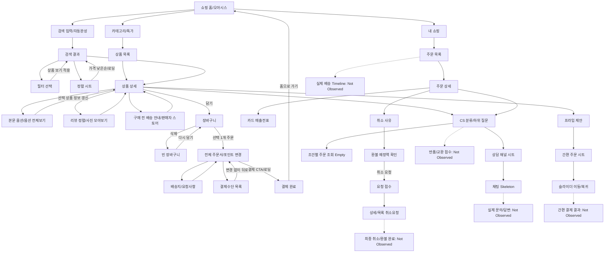

# Shopping Flow / Interaction — 녹화 1·2·3 누적

갱신일 2026-10-04. 근거·캡처·각 영상의 경과 시각은 [SCREEN_INVENTORY.md](SCREEN_INVENTORY.md)에 있다. 기존 녹화 1 원문은 [보존 문서 묶음](history/recording-1-docs.zip)에 남겼다. `Observed`는 실제 화면 변화, `표시만`은 실행 결과 미확인, `Not Observed`는 확인 못함, `Inferred`는 해석/설계 제안이다. 영상 간 시간 순서와 세션 연속성은 확정하지 않는다.

## 새로 연결된 실제 흐름

| Flow | Observed 경로 | 근거 / 확인 종료점 |
| --- | --- | --- |
| 검색 구매 탐색 | 오아시스 홈 → 검색 입력 → 치킨 자동완성 → 결과 → 필터 가격/분류 → 적용 결과 → 가격 낮은순 → 상세 | V3-01~18. 인기 검색/Empty는 없음 |
| 옵션 구성 → 카트 수량 | 베개 상세 64×40cm·2팩 선택 → 담기 → Cart 수량 1 → 상세에서 같은 구성 재담기 → Cart 수량 2 → Cart − → 1 | V3-17/21~23. 팩 2는 구성, 카트 2는 주문 수량 |
| 카트 → 결제 → 주문 | Cart 갈비 1개 선택 → 전체 주문서 → 포인트 158에서 0 → 6,990원 결제 CTA → 로딩 → 결제했어요 → 홈 → 사용자 아이콘 → 내 쇼핑 → 주문 전체보기 → 신규 주문 상세 | V2-23~31. 한 상품 결제 성공을 실제로 연결 |
| 주문 취소 요청 | 현재 주문 상세 결제완료 → 문의 분류·뒤로 → 상세 상품준비중 → 취소하기 → 사유 없음/단순 변심/주문 실수 → 예상 환불액 6,990원 → 취소 요청 → 접수 결과 → 상세/목록 취소요청 | V2-30/34~41. 판매자 승인 및 최종 환불은 없음 |
| 장바구니 비우기/복원 | 항목 삭제 → 마지막 항목 삭제 → Cart Empty → 삭제 Snackbar 다시 담기 → Cart 1개 복원 → 비용 펼침 | V2-49, V3 03:00~05, V3-25/26. 복구 유효 시간은 미확인 |
| CS 분류/주문 조회 | 상세 물음표 또는 주문 상세 문의하기 → 배송/취소/교환반품 분류 → 구체 질문 → 대상 주문 없음 안내 또는 상담 채널 → 채팅 Skeleton → 뒤로 | V2-07~17, V2 02:59~03:01. 문의 메시지 전송은 없음 |
| 리뷰 탐색 | 상세 리뷰 → 전체 리뷰 → 최신/별점 높은/낮은 정렬 → 사진 더보기 → 사진 모아보기 → 뒤로 | V3-27~30. 단일 사진/리뷰 상세 없음 |
| 상세 보조 탐색 | 상세 → 배송 예상 Sheet / 판매자 스토어 / 옵션 전체보기 / 가격 비교 목적지 / 전체 화면 갤러리 → 상세 복귀 | V2-21/22/43~46, V3-20. 실제 배송 추적·비교 데이터와 구별 |

## 탐색과 조건 적용

```text
Oasis Home
  → Search Input (최근 검색어·키보드)
  → "치킨" 입력 (자동완성 목록)
  → Search Results (추천순)
  → Search Filter (2만원 이하 → 닭/오리고기)
  → N개 상품 보기 → Results (필터 2개 표시)
  → Sort Sheet → 가격 낮은순 → 목록 이미지 Skeleton → 결과 갱신
  → 상품 선택 → Product Detail → 뒤로 Results
```

V3 00:57~01:01에는 필터에 재진입하고 **초기화 → Chip 강조 제거/402개 표시 → 뒤로 닫기**까지 진행한다. 결과는 **필터 2개·가격 낮은순을 유지**한다(V3-13/14). 결과 조건이 해제됐다고 기록하지 않는다. `Inferred`: 화면에서 편집 중 조건과 확정 조건을 구분하는 상태 모델이 필요하다. 다른 검색어 베개로 바꾸면 소재/형태 등 다른 조건이 보인다(V3-15). 최근 치킨 기록 추가도 V3 01:04~07에서 확인했지만 개별 X 삭제는 실행되지 않는다.

## 구매 경로와 서로 다른 결제 UI

```text
Product Detail → 선택 옵션 담기 → Cart
  → 개별 상품 체크 → 하단 선택 1개 주문하기
  → Full Checkout
       ↔ Address Selection (현재 주소 확인만)
       ↔ Delivery Request (기존 직접 입력값 저장만)
       ↔ Payment Method Selection (열고 뒤로, 수단 변경 없음)
       ↔ Prime Offer (가입 결과 없음)
  → 포인트 최대 사용 체크 해제 (158 유지)
  → 포인트 입력 0·확인 (6,832 → 6,990원)
  → 결제하기 (CTA 로딩)
  → Order Complete (결제했어요)
  → 홈으로 가기 → Home → My Shopping → Order List → Order Detail
```

주소/요청사항은 V2 첫 주문서에서, 결제수단 목록은 V3 끝 주문서에서 확인한 **별도 가지**다. 갈비를 결제한 한 주문에서 세 변경을 모두 수행한 것으로 연결하지 않는다. 쿠폰 변경 진입점과 약관/정보 제공 동의 문구는 표시만이다. 결제 완료 화면의 ‘주문 상세 내역 보기’는 보이지만 실제 눌린 경로는 ‘홈으로 가기 → 내 쇼핑 → 목록 → 상세’다.

녹화 1의 **구매하기 → 프라임 7일 비노출 체크 → 간편 주문 시트 → 슬라이더 오른쪽 → 초기 위치 복귀 → 닫기**(P01/P02/Q01~04)는 별도 경로로 유지한다. V2 01:53~56과 V3 01:32~35에도 비슷한 간편 주문 시트를 열고 닫는다. **간편 주문 슬라이더 승인 결과는 계속 Not Observed**이며, V2 전체 주문서 결제 성공으로 그 경로의 결과를 덮어쓰지 않는다.

## 구매 후 주문·취소·CS

```text
신규 Order Detail 결제완료
  ↔ 영수증 보기 → Card Receipt → 스크롤 → 뒤로
  ↔ 문의하기 → CS Topics → 뒤로
  → 같은 현재 주문 상품준비중 표시
  → 취소하기 → 사유 선택 (주문 실수)
  → 예상 환불액/판매자 승인 안내
  → 취소 요청 → "취소요청했어요"
  → 확인 → Order Detail 취소요청 → Order List 취소요청
  → [최종 취소완료·환불 진행·환불 완료: Not Observed]
```

사유 없음 상태의 다음 버튼은 흐리며 선택 후 밝아진다. 취소요청 상세에는 기존 취소 CTA가 사라지고 문의하기만 남는다. 준비중으로 바뀐 원인/서버 갱신 규칙은 미확인. 결제완료 상태의 즉시 취소 규칙은 **안내문 표시만** 관찰했고 실제로 취소한 상태는 상품준비중이다. 목록의 과거 취소완료와 구매확정은 **다른 주문**이며 이번 요청의 처리 완료 증거가 아니다.

```text
Product Detail 물음표 / Order Detail 문의하기
  → CS Topics
      → 배송 질문 → 지연/진행/완료 미수령/늦어서 취소
          → 조건별 대상 주문 없음 + 주문 목록 보기/문의하기 (CTA 표시만)
      → 취소 질문 → 취소 희망/취소됨
          → 주문 상품 없음 / 판매자 취소 없음
      → 교환·반품 질문 → 반품 희망/교환 희망 (항목 표시만)
      → 기타 → CS Channel Sheet
          → 채팅 상담 → Chat Skeleton → 뒤로
          → 전화 상담 (연결 결과 Not Observed)
```

주문 목록의 배송 조회 버튼은 표시만이다. 상품 상세의 배송정보 Sheet는 구매 전 예상일/택배사 안내다. **Order Detail → 실제 배송 추적**, **반품/교환 신청**, **환불 상태 조회**, **문의 메시지/접수/답변/내역**은 아직 연결할 수 없다.

## 누적 Flow Mermaid

실선은 실제 이동을 확인한 경로다. 점선은 표시만 또는 Not Observed 경로이며 같은 영상 한 번의 세션에서 모든 가지를 실행했다는 의미는 아니다.



## 추가 영상 전체 타임라인

녹화 2·3 모두 끝까지 검토했다. 반복 방문·정지 구간은 아래에서 묶으며 새로운 PNG를 만들지 않았다. 구간 경계는 대략값, 대표 프레임 요청 시각은 인벤토리 표가 기준이다.

### 녹화 2 — 05:16.46

| 구간 | 실제 화면/동작 | 근거 / 주의 |
| --- | --- | --- |
| 00:00~00:15 | 전체 주문서 → 주소 현재 확인 → 기존 배송 요청 저장 → 할인/포인트/합계 스크롤 → 프라임 제안 | V2-01~05. 시작 주문서 진입은 없음 |
| 00:15~00:22 | Cart → 소시지 상세 → 이미지 번호 1/5·2/5·4/5 | V2-06. 옵션 후보 표시 |
| 00:22~00:40 | 상세 물음표 → CS 배송/취소/교환반품/기타 → 상담 채널 → Chat Skeleton → 뒤로 | V2-07~12 |
| 00:40~00:59 | 배송/취소 하위 질문 → 조건별 대상 주문 없음 → 기타 채널 → 상세 복귀 | V2-13~17. 반품/교환 접수 아님 |
| 00:59~01:14 | 중량 1.32kg ↔ 1.5kg·가격/판매자/리뷰 변화; 리뷰 탐색 | V2-18. 도움됐어요 선택 결과 없음 |
| 01:14~01:26 | 품절 상세·선택된 찜 하트 표시 → 전체 갤러리 사진 전환 → 상세/홈 | V2-19/21/22. 찜 해제 없음 |
| 01:26~01:57 | 홈/갈비 상세 탐색, 간편 주문 로딩·시트 열고 닫기 | Q01~02 패턴 반복, 성공 없음 |
| 01:57~02:11 | 갈비 담기 → Cart 3개·전체 해제·갈비 1개 선택 → 전체 주문서 | V2-23/24 |
| 02:11~02:22 | 주문서 쿠폰 없음/카드/포인트; 최대 체크 해제 → 0 입력·확인 → 합계 6,990 | V2-25/26. 체크 해제만으로 158이 0이 되지 않음 |
| 02:22~02:30 | 결제 CTA 로딩 → 결제했어요 → 홈으로 가기 | V2-27 |
| 02:30~02:43 | 홈 → 내 쇼핑 → 주문 전체보기 → 신규 주문 상세 | V2-28~30 |
| 02:43~02:59 | 주문 상세 스크롤 → 카드 전표 → 공급자/세금/합계 → 복귀 | V2-31~33 |
| 02:59~03:03 | 문의 분류 → 상세 복귀 시 상품준비중 → 취소 진입 | V2-34 |
| 03:03~03:16 | 사유 미선택→단순 변심→주문 실수 → 환불 예정 → 취소 요청 → 접수·상세·목록 | V2-35~41 |
| 03:16~03:38 | 내 쇼핑에 취소요청 현재 주문; 화면 정지 | 추가 상태 변화 없음 |
| 03:38~04:03 | 홈·추천 → 용기 상세 할인 펼침 → 구매 전 배송정보 → 판매자 스토어 | V2-42~44 |
| 04:03~04:19 | 옵션 전체보기 → 다른 구성 선택·가격 갱신 → 각 구성 담기 → 중복 담기 한도 Modal | V2-45~47 |
| 04:19~04:38 | Cart 항목 삭제·할인 펼침 → 마지막 항목 삭제 Empty → 상세/홈 복귀 | V2-48/49. 재담기 실행은 녹화 3에서 별도 확인 |
| 04:38~05:00 | 홈·카테고리 이동·더 아래 대분류 → 문구·학용품 | 반복 홈/동형 카테고리는 추가 캡처 안 함 |
| 05:00~05:16.46 | 문구 목록 → 카테고리 → 신선식품 로딩/목록 → 품절 상세 → 목록 복귀·끝 | V2-50; 기존 품절/Skeleton 패턴 반복 |

### 녹화 3 — 04:15.26

| 구간 | 실제 화면/동작 | 근거 / 주의 |
| --- | --- | --- |
| 00:00~00:07 | 오아시스 → 검색 입력·최근 → 치킨 자동완성 → 결과 | V3-01~03 |
| 00:07~00:20 | 결과 스크롤·조건 행 가로 이동·상단 복귀 | V3-04. 조건 행 이동과 선택 적용을 혼동하지 않음 |
| 00:20~00:28 | 필터 → 가격≤2만원 → 닭/오리고기 → 적용 결과 | V3-05~08 |
| 00:28~00:39 | 특징 Tab → 결과 → 정렬 Sheet 열고 변경 없이 닫기 | V3-09/10 |
| 00:39~00:54 | 결과 더 탐색 → 정렬 다시 열기 → 가격 낮은순 → Skeleton/결과 | V3-11/12 |
| 00:54~01:07 | 필터 재진입 → 초기화 → 적용 없이 닫기 → 기존 결과 조건 유지 → 검색 최근 기록 | V3-13/14 |
| 01:07~01:19 | 검색창 재진입 → 베개 자동완성 → 베개 결과 → 상세 | V3-15/16 |
| 01:19~01:38 | 1/2/4팩 옵션 변경 → 상세 구역·간편 주문 시트 → 닫기 → 담기 | V3-17/18, 기존 시트 반복 |
| 01:38~01:55 | 결과에 유사 추천 → 상세 재진입 → 가격 비교 빈 본문 → FREE/60×40cm 크기 변경 | V3-19/20. 비교 데이터 없음 |
| 01:55~02:20 | 리뷰/상세/추천 탐색 → Cart 수량1 → 상세·간편 주문 시트 → 닫기 → 같은 옵션 담기 | V3-21 |
| 02:20~02:32 | Cart 수량2 → −로1/금액 재계산 → 다른 항목 삭제/Empty → 최근 본·찜 목록 | V3-22~24 |
| 02:32~03:06 | 치킨 검색 조건 복귀 → 상품 선택/담기 → Cart 선택 삭제 → Empty → 다시 담기 → 합계 펼침 | V3-25/26. 보상 안내를 주문 성공으로 보지 않음 |
| 03:06~03:38 | Cart/홈/소시지 상세 → 할인 내역 펼침 → 담기 | 쿠폰 3,200원 표시, 별도 쿠폰 선택은 없음 |
| 03:38~03:49 | 전체 리뷰 → 최신/높은/낮은 정렬 → 사진 모아보기 스크롤 → 뒤로 | V3-27~30 |
| 03:49~04:07 | 소시지 중량 변경/복귀 → Cart 전체해제/소시지선택 → 쿠폰 가격 재계산 → 주문서 | V2-18/23 패턴 재확인, 중복 PNG 생략 |
| 04:07~04:15.26 | 전체 주문서 → 결제수단 선택 목록 잠깐 열기 → 변경 없이 복귀·끝 | V3-31. 결제 실행 결과 없음 |

## 녹화 1 타임라인 보존

다음 표는 첫 영상의 실제 종료점까지다. 당시의 Not Observed 판정은 녹화 1에 한정하며 누적 판정은 위 흐름과 다음 Interaction 표를 따른다.

| 구간 | 화면 / 상태 변화 | 관찰 근거와 한계 |
| --- | --- | --- |
| 00:00–00:09 | 쇼핑 홈 → 추천 목록 스크롤 → 홈 상단 → 배너 변경 | H01~H03. 배너 자동/수동 전환 원인은 불명 |
| 00:09–00:12 | 배너 상품 → 닭다리 상세 → 일부 스크롤 | PD01~PD02. 가로 페이지 전환, 헤더 배경 변화 |
| 00:12–00:16 | 찜 등록 → 등록 피드백 시트 → 추천 행 가로 이동 → 닫힘 | W01~W02. 하트 채워짐, 시트는 옵션 선택 화면이 아님 |
| 00:16–00:19 | 찜 상태 상세 → 장바구니 담기 → 성공 Snackbar | PD03~PD04. 배지 7 → 8; 옵션 시트를 거치지 않음 |
| 00:19–00:22 | 장바구니로 가로 전환 → 잠깐 빈 본문 → 8건 목록 | CT01. 빈 본문은 곧 목록으로 바뀌므로 Empty State로 보지 않음 |
| 00:22–00:25 | 장바구니 스크롤, 배송 묶음·다른 상품 확인 | CT02. 주문 CTA 하단 유지 |
| 00:25–00:28 | 상품 X → 해당 항목 사라짐 → 삭제 피드백 → 7건 | CT03. 개별 삭제 확인 Modal은 이 경로에서 안 보임 |
| 00:28–00:31 | 상단 복귀 → 전체 선택 해제 | CT04. 상품은 남음, 주문 CTA가 흐려지고 금액 로딩 표시 |
| 00:31–00:32 | 오아시스 그룹 선택 → 해당 두 상품 체크됨 → 선택 삭제 Modal | CT05~CT06. CTA의 로딩 점 후 2건·10,600원 표시 |
| 00:32–00:34 | 선택된 2개 삭제 확인 → 5건 → 선택 없음·삭제 Snackbar | CT07. 이후 주문 CTA는 흐리게 표시 |
| 00:34–00:35 | 뒤로 상세 복귀 | 기존 상품 상세. 삭제 Snackbar가 잠시 다음 화면 위에도 남음 |
| 00:35–00:37 | 0원 뽑기 → 프로모션 시트 → 닫힘 | Z01. 안내만 확인, 당첨/수령 결과 없음 |
| 00:37–00:39 | 상세 → 홈 → 같은 상세 재진입 | 동일 내용의 반복 방문은 추가 이미지로 집계하지 않음 |
| 00:39–00:43 | 상세 스크롤 → 본문의 1/2/3팩 선택 후보 | PD05. 1팩 초기 선택; 옵션 변경은 실행되지 않음 |
| 00:43–00:44 | 상세 평점 행 → 전체 리뷰 화면 → 뒤로 | RV01. 별도 페이지의 좌우 전환 |
| 00:44–00:47 | 상세 본문의 리뷰 요약·후기 → Sticky 탭 | RV02~RV03. 평점 4.8·리뷰 1,123개 표시 |
| 00:47–00:51 | 상품 정보 구역 → 자세히 보기 → 긴 설명 이미지 스크롤 | PD06~PD07. 리뷰/상품 정보 탭과 구매 CTA 유지 |
| 00:51–00:57 | 홈 복귀 → LA갈비 상세 → 리뷰 본문 스크롤 | PD08. 하루 최대 1개 안내. 리뷰 평점/내용은 다른 상품 값 |
| 00:57–01:02 | 홈 복귀 → 세로 이동 → 보상 바로가기 가로 이동 | H04. 상품 뽑기/리뷰 쓰기 등 바로가기 노출 |
| 01:02–01:05 | 뷰티 → 오아시스 탭 | BH01/OH01. 목적지 콘텐츠 실제 변경 |
| 01:05–01:10 | 카테고리 → 식품/생활용품/패션/뷰티 | C01~C04. 선택 표시와 우측 노출 영역 이동 |
| 01:10–01:12 | 뷰티 전체보기 → Skeleton → 상품 목록 → 뒤로 | L01~L02. 검색 결과가 아닌 카테고리 목록 |
| 01:12–01:16 | 특가 탭 → 하루 특가 → 스크롤 → 첫 상품 선택 | D01~D02 |
| 01:15.7–01:17 | 닭강정 상세의 짧은 Skeleton → 정보 로드 | PD09~PD10. Skeleton은 진입 전환과 겹침 |
| 01:17–01:23 | 상세 스크롤 → 찜 등록 시트 → 닫힘 | W01 패턴 반복. 등록 후 하트 채워짐 |
| 01:23–01:30 | 구매하기 → 프라임 안내 → 7일 비노출 체크 → 바로 주문 경로 | P01~P02. 가입 완료 화면 없음 |
| 01:30–01:31 | 간편 주문 시트 → 로딩 점 → 슬라이더 준비 | Q01~Q02. 배송지·선택 카드·포인트 사용 표시 |
| 01:31–01:36 | 슬라이더 왼쪽 → 오른쪽 → 왼쪽 복귀 | Q03~Q04. 결과 안내와 주문 완료 없음 |
| 01:36–01:38 | 시트 닫힘 → 원래 상세 | 닫기 입력은 터치 표시가 없어 확정하지 않음 |
| 01:38–01:41 | 상세 리뷰 스크롤 → 장바구니 진입 | 다른 상품의 리뷰가 보임; 주문 조회가 아님 |
| 01:41–01:46 | 5건 전체 선택 장바구니 → 스크롤 → 최근 본 탭 | CT08. 81,940원 주문 CTA 표시 |
| 01:46–01:48 | 최근 본 → LA갈비 카드 제거·재배치·X 노출 → 상품 상세 | RC01~RC02. 삭제 모드 진입 입력은 Inferred |
| 01:48–01:55 | 상세 → 하루 특가 복귀 → 목록 왕복 스크롤 | D01~D02 패턴 반복 |
| 01:55–01:57 | 셀러 특가 → 기획전 → 쿠폰 혜택 | SD01/CP01/CB01. 쿠폰 혜택은 로딩 뒤 랭킹 노출 |
| 01:57–02:00.60 | 환절기 탭 → 쇼핑 홈, 녹화 종료 | SH01 → H03 계열. 주문·배송·CS로 이어지지 않음 |

## Interaction 확인표 — 누적 갱신

| Interaction | 판정 | 근거 | 남은 한계 |
| --- | --- | --- | --- |
| 상품 누르기/상세 진입 | Observed | 홈/분류/검색/카트/찜 → 상세 PD01, V2-50, V3-16/24 | 터치 좌표·카드 내부 클릭 대상의 모든 차이는 미확인 |
| 상품 이미지 전환/큰 보기 | Observed | V2-06/21/22 이미지 번호·내용·선택 썸네일 변화 | 핀치 확대·정확한 스와이프/썸네일 입력 구분 Not Observed |
| 찜 등록/해제 | 등록 Observed; 해제 Not Observed | W01/PD03, V2-19 품절 상세 하트는 표시만, V3-24 목록 | 하트 해제/목록 X 결과·동기화 없음 |
| 옵션 선택 전/후·순서 | Observed | V3-16→17→18 크기 선택 상태에서 팩 변경; V2-18 중량 변경 | 색상→크기 종속 구매 Sheet/필수 순서 Not Observed |
| 옵션 Sheet | Observed | V2-45 전체보기 → V2-46 다른 구성 상세 | 구매 전용 Sheet와 구별, 품절 옵션 없음 |
| 옵션별 가격·메타 변화 | Observed | V2-18, V3-16~18 가격·리뷰·판매자·예정 변경 | 정확한 variant/seller 내부 ID 관계는 Inferred |
| 품절/최대 한도 | Observed | V2-19 품절; V2-47 1개 구매 한도 Modal | 품절 옵션·품절 CTA 실제 탭·한도 Reset Not Observed |
| 담기/성공 피드백 | Observed | PD04, V3 01:37~38 Snackbar/배지 증가 | 상품 비교·옵션 선택과 담기 성공을 분리 |
| 수량 증가/감소 | Observed — 제한된 경로 | V3-21→22 동일 옵션 재담기 1→2; V3-22→23 −로2→1 | 카트 + 직접 증가/최대치·서버 실패 Not Observed |
| 개별/전체/묶음 선택 | Observed | CT04~06 + V2-23/V3 04:02~07 개별 체크·총액 재계산 | 초기화·재실행 시 복원 정책 미확인 |
| 개별/선택 상품 삭제 | Observed | CT03/06/07 + V2-49 Empty | 일부 실패·동시 변경 Not Observed |
| 삭제 Undo | Observed | V3 03:00 삭제/Empty → 다시 담기 → V3-25 복구 | 유효 시간·재고 변경·복구 실패 미관찰 |
| 선택 상품 결제 | Observed | V2-23→24→27 갈비 1개 | 여러 상품/판매자 주문서·부분 실패 Not Observed |
| 카트 품절 항목 | Not Observed | 품절은 상세에서만 확인 | 카트 Disabled/자동 해제/대체 필요 P0-03 |
| 카트 비용 펼침 | Observed | V2-48 상품 할인, V3-26 합계/배송비 | 선택에 따른 쿠폰 분배 전체 규칙 미확인 |
| 뒤로/Tab/Bottom Navigation | Observed — 부분 | 상품/리뷰/카트/필터/CS/주문 뒤로; 쇼핑 탭·찜·최근 본 전환 | 앱 홈/혜택/증권/전체 목적 화면 Not Observed |
| Transition | Observed | 페이지 좌우 전환, Sheet 아래서 노출·Dim, Popup 표시 | 정확한 이동 시간/easing/제스처 닫기 Not Observed |
| 하단 Fixed CTA | Observed — 촬영 구간 | 상세/리뷰/Cart/전체 주문서 스크롤에서 하단 유지 | 모든 화면·키보드 상태에서 같은 규칙이라고 일반화 안 함 |
| Scroll Header / Sticky | Observed | H02 축약, PD02 불투명, RV03 리뷰탭, V3-03/04 결과 조건 유지 | Header 임계점·구현 구조는 Not Observed |
| Sheet 열기/닫기 | Observed | 옵션/배송/프라임/정렬/상담/간편 주문 | 옵션 선택 후 자동 닫힘 관찰; 바깥 탭/드래그 규칙 미확인 |
| Modal | Observed | CT06 선택 삭제 확인, V2-47 구매 한도 | Alert와 Bottom Sheet를 다른 패턴으로 기록 |
| Toast/Snackbar | Observed | 담기·삭제·Undo 진입점, 일부 다음 화면에도 유지 | 명확한 자동 사라짐 시간·전역 구현은 미확인 |
| Loading/Skeleton | Observed | L01/PD09/Q01/CT05 + V3-11 이미지/목록, V2-12 Chat | 로딩을 Empty/Error/접수 성공으로 바꾸지 않음 |
| Empty | Observed | V2-49 Cart, V2-13~17 CS 조건별 주문 없음 | 검색/찜/주문 전체 Empty는 Not Observed |
| Error/Network Error | Not Observed | 가격 비교 빈 본문·Chat Skeleton은 에러 문구 없음 | 일반 오류/재시도 캡처 P1-07 필요 |
| Disabled | Observed — 외형만 | 품절 CTA, 취소 사유 없음 다음, 선택 없음 Cart | 실제 눌러도 무반응/차단되는 동작은 Not Observed |
| 주소/배송 요청 | Observed — 열기·기존 값 확인 | V2-02/03 | 값 변경 저장/주소 CRUD/배송 요청 Validation 없음 |
| 결제수단/쿠폰 선택 | Observed — 표시만/목록 열기 | V3-31, V2-01 변경 버튼 | 다른 수단/쿠폰 적용 결과 없음 |
| 포인트 변경 | Observed | V2-25 최대 체크 해제해도158 유지, V2-26 0 입력·총액 변경 | 양수 일부 사용/잔액 초과 오류·내역 없음 |
| 결제 Success / Failure | Success Observed; Failure Not Observed | V2-27/29 신규 주문 결제완료 | 인증·결제 취소·재결제·중복 요청·간편 결제 결과 없음 |
| 주문 상태/취소 | Observed — 요청까지 | V2-30/34/40 결제완료→상품준비중→취소요청 | 최종 취소·부분 취소·취소 불가 상세 미관찰 |
| 실제 배송 추적 | Not Observed | V2-43은 구매 전 안내; V2-29 조회 CTA 표시만 | 준비/이동/완료/지연 Timeline P0-07 |
| 반품/교환/환불 | 신청/진행 Not Observed | V2-10 문의 항목, V2-38 환불 예정액 표시만 | 자격/사유/회수/비용/옵션/접수/완료 P0-08~10 |
| CS 실제 문의 | Not Observed | V2-11 채널, V2-12 Skeleton까지 | 메시지 작성·전송·접수·내역·답변 P0-11 |
| 리뷰/사진/도움/작성 | 정렬/사진 모아보기 Observed | V3-27~30 | 단일 상세/사진 확대/도움 체크/리뷰 작성 P1-02/08 |

## 후속 설계에 필요한 상태 분리 — Inferred

상품 옵션(팩/중량/크기)과 주문 수량, 옵션 변경에 따른 판매자·가격·리뷰, 편집 중 검색 조건과 적용된 조건, 카트 선택 가격과 미선택 가격, 포인트 최대 체크와 실제 금액, 요청 접수와 최종 취소/환불, 주문 배송 상태와 구매 전 예상일, CS 분류 조회와 상담 접수를 각각 구분해야 한다. 이는 관찰을 바탕으로 한 기능 명세 방향이며 실제 API 상태명이나 정책으로 확정하지 않는다.
